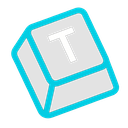
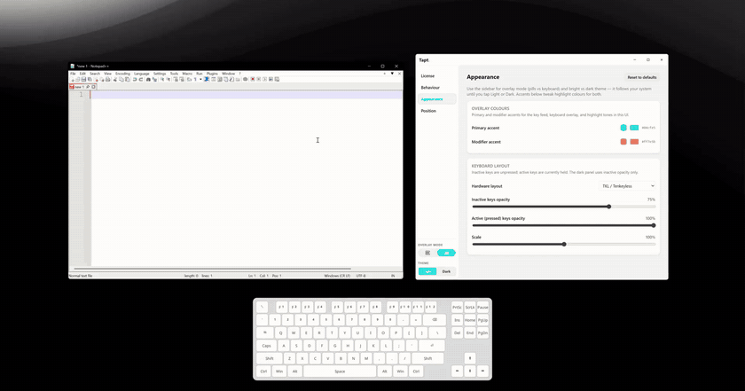

# Tapt

**See every keystroke. Live, on screen, on stream.**

A Windows overlay for streamers, screencasters, tutorial makers, and live demos. 
Native, lightweight, transparent, click-through, always on top, and visible to OBS.

 

Free 1-hour trial built in. One-time payment, not a subscription.

 

---

## Highlights

- **Live key display.** Your viewers see what you press, without a camera on your keyboard.
- **Two modes.** A key feed of pills that fade out, or an on-screen keyboard (60%, tenkeyless or full size).
- **Stays out of the way.** Transparent, click-through, always on top, controlled from the tray, works on any monitor.
- **Make it yours.** Light and dark themes, accent colors, sizes, opacity and placement.
- **Built for creators.** Streams, tutorials, product demos and accessibility walkthroughs.

---

## Pricing

Every download includes a **free 1-hour trial**, and it only counts down while the overlay is on. After that, there's one price:

| Plan | Price | |
|------|-------|---|
| Lifetime | **$2.99** once | **[Buy lifetime](https://buy.stripe.com/dRmaEZbo20ze4A4bTZe3e03)** |

Checkout is through Stripe and your key arrives by email right away. One key activates up to 5 PCs.

---

## Download

1. Download **[TaptSetup.exe](https://github.com/RAZKOM/Tapt/releases/latest/download/TaptSetup.exe)** (or browse all [releases](https://github.com/RAZKOM/Tapt/releases)).
2. Run it and finish setup.
3. Tapt opens its settings and lives in the system tray. Click the tray icon to open settings again.

**Requirements:** Windows 10 or later. WebView2 is usually preinstalled; if Tapt won't start, install the [WebView2 runtime](https://developer.microsoft.com/en-us/microsoft-edge/webview2/) from Microsoft.

Tapt tells you when a new version is out.

---

## Activation

Tapt runs as a free trial until you activate it. After checkout, paste the key from your email into the **License** tab. Activation needs the internet once; after that, Tapt never checks online again.

---

## Support

Questions, activation problems or a new PC? Email **[hello@razkom.com](mailto:hello@razkom.com)**.

---

## Privacy

Your keystrokes never leave your PC. Tapt draws them on screen and doesn't log or store them. The only times it goes online are the one-time license activation and a check for new versions on GitHub.

---

## Open source

Tapt is open source under the **GPL-3.0**. Buying the official build is the easy way to get it, and it pays for development. Building it yourself is free.

Self-built copies don't include the official license credentials, so they run as the 1-hour trial. The GPL lets you change that in your own build. See **[docs/DEVELOPMENT.md](docs/DEVELOPMENT.md)** for how to build, run and release Tapt.

Bug reports and pull requests are welcome.

## License

Tapt is licensed under the [GNU General Public License v3.0](LICENSE). The bundled Noto fonts are under the [SIL Open Font License](src-tauri/assets/fonts/OFL.txt).

The Tapt name and logo are not covered by the GPL. If you distribute a modified version, please give it a different name and icon.
